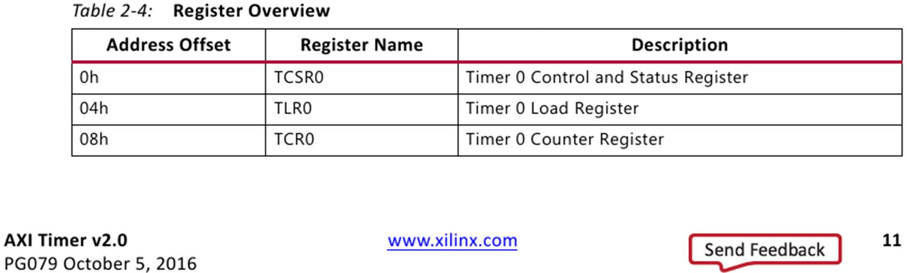
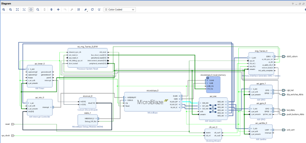
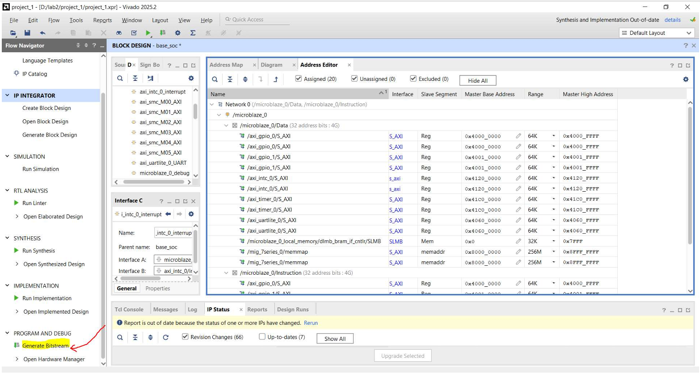

# Crosswalk-TrafficLight-Simulator--OnFPGA

# Models a crosswalk for bikes/pedestrians w/ state-interruptible push-buttons  

## Summary
I used Vivado2025.2 to configure GPIO modules, RGB LEDs, Green LEDs, push-buttons, dipswitches/toggle switches, modules’ memory addresses, & then compile a bitstream for flashing to [ARTY A7-100T hardware](https://digilent.com/shop/arty-a7-100t-artix-7-fpga-development-board/)’s FPGA platform.  
* As of Oct 20, 2026, the ARTY A7-100T costs $322. The non-100T version ("35T") cost $99 in 2020.

I used Vitis2025.2 to create, debug, & comprehensively test my state-to-state transition logic in C code to implement the following states and transitions of the traffic lights:  
* **green** (default state) → **blinking red** (for 6 seconds, extensible upon any of 4 buttons being pushed) → **solid red** (4 seconds, uninterruptible) → **blinking red** (for 6 seconds, uninterruptible) → **green** (default state).

Also in Vitis2025.2, I designed:
* button-polling (i.e., checking whether a button is pressed)
* visible blinking of RGB LEDs
* dimming of RGB LEDs (i.e., rapid and invisible blinking)
* millisecond-based timing/delays
* non-primary-color-display (e.g., Yellow=3msRed+2msGreen) functionalities to 4 RGB LEDs
* ***all the above functionalities occurring nearly simultaneously (on a human’s time-scale)***
 
 

## Requirements for running/execution
Required hardware:    Inputs from and outputs to ARTY A7-100T chip’s FPGA platform.  
Physical components:  Push-buttons, RGB LEDs.  
Required software:    Execute this code in Vitis2025.2  
* Requires the softcore-CPU bitstream that defines the FPGA's hardware configuration, which altogether is an `.xsa` file generated by Vivado2025.2 - not included in this repository for now.
  * By "hardware configuration", I mean the 1) gate layouts that define each Functional Unit, and 2) timing/ClockRate/NumClockCyclesPerSecond configurations, and 3) memory address layouts for gates and for sub-chip/component ports.  
  * Example Functional Units (FUs)/Components:
    * AXI Timer ("axi_timer_0")
    * AXI Interrupt Controller ("axi_intc_0")
    * Memory Interface Generator ("MIG 7 Series")
    * Processor System Reset ("rst_mig_7series_0_81M")
    * MicroBlaze ("microblaze_0")
    * MicroBlaze Debug Module ("mdm_1")
    * AXI SmartConnect ("axi_smc")
    * Clocking Wizard ("clk_wiz_0")
    * AXI Uartlite (interfaces with the physical USB port that is connected to the UART)("axi_uartlite_0")
    * two AXI GPIO (one for having its two ports interface the 4 RGB LEDs and 4 dipswitches, and the other for having its two ports interface the 4 Green LEDs and 4 pushbuttons)("axi_gpio_0", "axi_gpio_1" - these component names are NOT to be confused with the port names that exist within each component, port "GPIO" and port "GPIO2" for each component)
* Provided code is written in `C` language, which compiles *not* onto a general-purpose computer, but rather onto a specially-configured FPGA-specific bitstream that defines a software-defined/"softcore" CPU (again, the `.xsa` file is not included in this repo).  

**This project *cannot* be run in typical C compiler/executer due to hardware-specific Functional Units with specific hardware-to-software memory layout addresses/ports. This means that you cannot run this on `onlinegdb.com` and expect it to magically work.**
* You would also *physically* need some RGB LEDs and push-buttons that are all somehow accessible to and from your computer, which `onlinegdb.com` wouldn't let you do.
 
 

# Relevant images

## Xilinx Datasheet - Mem Offsets of Timer Component's *Registers*

A snippet extracted from a 2016 Xilinx datasheet on the AXI Timer device (specifically "Table 2-4").  

This excerpt shows the memory offsets of each of the three timer registers per timer component - TCS, TL, TC.  
* Each offset's format is in &nbsp; hexadecimal(...`h`) &nbsp; unsigned(`0`...) &nbsp; bytes.

These three address offsets (0, 4, 8, respectively) are relative to the Base Address of the entire Timer0 component.  
* TCSR0 is 'Timer(Component#)0 - Register (for) Control (and) Status (together)'.
  * This register contains Control flags and Status flags.  
* TLR0 is 'Timer(Component#)0 - Register (for) Load'.
  * This is the register in which the user stores `#ClockCyclesEquivalentToASpecifiedTimeDuration`.
* TCR0 is 'Timer(Component#)0 - Register (for) Counter'.

Read the full `AXI Timer` datasheet for how to use (and more importantly, how *not* to use) these three registers.

  
 

## Vivado - Block Diagram of all FUs placed on FPGA

Refer to the Functional Units (FUs) listed earlier in this `README.md` file. These will be what appear in this below screenshot.  

This screenshot shows a Block Diagram (BD) of interconnected 'blocks'/'FUs', where each 'block' is a component that can interface with other components (via that component's 'port(s)') on the overall board/FPGA.  
Each connection between a component and another component is representing a physical wire (or a group of wires, called a 'bus').  

  
 

## Vivado - Mem Offsets of all FUs
A screenshot of mutually exclusive (i.e., non-conflicting) memory addresses associated with all ports on all components on the softcore FPGA:
  
 

